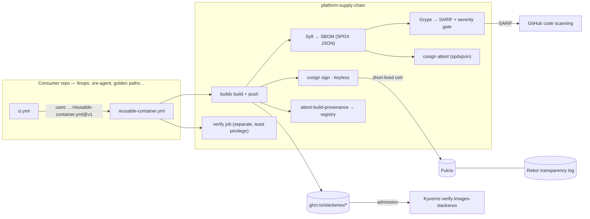

# platform-supply-chain

**Reusable GitHub Actions workflows that make every container image in the homelab provable.** Build → SPDX SBOM →
vulnerability gate → **cosign keyless signature** → **SLSA build provenance** → an independent `verify` job that
fails if any of those is missing or was issued to an identity nobody trusts.

One pillar of the [Platform Engineering Lab](https://github.com/slackerwx). It is the pillar every other one waits
for: `platform-policies` ships a Kyverno rule that only admits `ghcr.io/slackerwx/*` images carrying a keyless
signature from a `slackerwx` workflow on `main`. Until this repository produces those signatures, that rule cannot
leave Audit mode.

It is also the one public repository among the pillars — partly because GitHub only issues build attestations to
public (or Team/Enterprise) repositories, and mostly because a supply-chain pipeline you cannot read is one you
cannot audit.

## Architecture



Nothing here runs in the cluster — this pillar has no ArgoCD `Application` and no namespace. Its outputs are
(a) workflows other repositories call and (b) signatures and attestations sitting in GHCR next to each image, which
Kyverno checks at admission time.

## Use it from another repository

```yaml
jobs:
  container:
    uses: slackerwx/platform-supply-chain/.github/workflows/reusable-container.yml@v1
    permissions: {contents: read, packages: write, id-token: write, attestations: write, security-events: write}
    with:
      image_name: my-service
      push: ${{ github.event_name != 'pull_request' }}
```

That is the whole adoption cost. Pull requests still build and scan — they just do not publish or sign, because a
signature must only ever be produced from `main`; that is precisely what the Kyverno subject regex trusts.

### `reusable-container.yml`

| Input | Type | Default | Meaning |
|---|---|---|---|
| `image_name` | string | *(required)* | name without registry → `ghcr.io/<owner>/<image_name>` |
| `context` | string | `.` | build context |
| `dockerfile` | string | `Dockerfile` | path from the repository root |
| `platforms` | string | `linux/amd64` | buildx platforms |
| `push` | boolean | `true` | publish + sign + attest |
| `fail_on_severity` | string | `critical` | Grype gate: `negligible`\|`low`\|`medium`\|`high`\|`critical` |
| `only_fixed` | boolean | `true` | gate only on vulnerabilities that have a fix available |

Outputs: `image` (`ghcr.io/owner/name@sha256:…`), `digest`, `tags`.
Required caller permissions: `contents: read`, `packages: write`, `id-token: write`, `attestations: write`,
`security-events: write`.

### `reusable-python-quality.yml`

`working-directory` (`.`), `python-version` (`3.12`), `run-mypy` (`true`). Runs `uv sync --extra dev`, `ruff check`,
`ruff format --check`, `mypy`, `pytest --cov`.

### `reusable-iac-scan.yml`

`path` (`.`), `kubeconform-paths` (space-separated; kustomize directories are built first), `trivy-severity`
(`HIGH,CRITICAL`). Trivy misconfiguration scan with SARIF upload, plus kubeconform schema validation.

## Verify an image yourself

The point of signing is that **you do not have to trust the pipeline's word for it**. From any machine with `cosign`,
`jq`, `gh` and `openssl`:

```bash
GHCR_TOKEN=<PAT with read:packages> \
  ./scripts/verify-image.sh ghcr.io/slackerwx/platform-supply-chain-hello:<sha7>
```

It checks the signature, the signed SPDX attestation and the SLSA provenance, prints an SBOM summary, and exits
non-zero if anything is missing. The raw commands, if you prefer them by hand:

```bash
cosign verify \
  --certificate-oidc-issuer https://token.actions.githubusercontent.com \
  --certificate-identity-regexp '^https://github\.com/slackerwx/[^/]+/\.github/workflows/[^@]+@refs/heads/main$' \
  ghcr.io/slackerwx/<image>@sha256:<digest>

cosign verify-attestation --type spdxjson \
  --certificate-oidc-issuer https://token.actions.githubusercontent.com \
  --certificate-identity-regexp '^https://github\.com/slackerwx/' \
  ghcr.io/slackerwx/<image>@sha256:<digest>

gh attestation verify oci://ghcr.io/slackerwx/<image>@sha256:<digest> --owner slackerwx
```

## The repository proves its own pipeline

`example/hello-supply-chain/` is a stdlib-only HTTP service with two routes. Every push to `main` sends it through
the same three reusable workflows any consumer calls, so a break in the pipeline turns *this* repository red before
it reaches anyone else's. It has no runtime dependencies on purpose: its SBOM is short enough to read by hand, which
is what makes the exercises in [`docs/LEARNING.md`](docs/LEARNING.md) possible.

## Design decisions

**Keyless over long-lived keys.** cosign keyless mints a short-lived certificate from Fulcio bound to the workflow's
OIDC identity and records the signature in Rekor. There is no private key to store, rotate or leak, and the thing
policy asserts is the *identity* (repo + workflow + ref), not possession of a secret. Rejected: a cosign key pair in
a GitHub secret — key management burden, and a leaked key signs anything.

**GitHub artifact attestations for provenance, not `slsa-github-generator`.** `actions/attest-build-provenance`
produces a signed provenance statement, pushes it to the registry next to the image, and verifies with both
`gh attestation verify` and `cosign verify-attestation`. The SLSA generator reaches a higher formal level (isolated
builder) at the cost of a second build path and a lot more moving parts. [`docs/slsa.md`](docs/slsa.md) records
exactly what we do and do not meet, and what the upgrade would take.

**Scan the SBOM, not the image again.** Grype reads the SPDX document Syft already produced: faster, and the
inventory that gets scanned is provably the same one that gets attested.

**Gate on `critical`, and only on what is fixable.** A new HIGH CVE in a base image should not block unrelated
work, so the default cutoff is `critical`. `only_fixed: true` is the less obvious half: `python:3.12.14-slim`
currently ships seven CRITICAL CVEs in `perl-base` and `libc6` that Debian has marked *wont-fix*. There is no newer
patch release to move to — a gate that blocks on them blocks every build in the lab forever, which does not make
anything safer, it just teaches everyone to ignore red.

Gating and reporting are therefore separate steps. The gate blocks on vulnerabilities the build can act on; a
second, non-blocking Grype run publishes **every** finding to the job summary and uploads it as an artifact, so
nothing is filtered out of sight. And the SBOM is signed and attached to the image, so anyone can re-scan it later
under a stricter policy without rebuilding. Consumers that want a harder gate pass `fail_on_severity: high` or
`only_fixed: false`; VEX (`openvex`, backlog) is the way to suppress specific un-exploitable CVEs instead.

Alternatives considered and rejected: switching the base image to Alpine or distroless would make those seven CVEs
disappear, but "change distro until the scanner goes quiet" is a worse habit than "gate on what is actionable", and
musl breaks the manylinux wheels the real consumers of this Dockerfile need.

**Every action is pinned by commit SHA**, with the version in a trailing comment. Tags are mutable — a repository
that tells other people to verify their artifacts does not get to trust a floating tag.

## Owner checklist

Steps that need the owner (or the cluster) rather than CI:

0. **This repository is public**, unlike the other pillars. `actions/attest-build-provenance` refuses to persist an
   attestation for a user-owned *private* repository, and a pipeline nobody can read is a pipeline nobody can audit.
   The GHCR packages remain private; repository visibility and package visibility are independent. If you want an
   outsider to be able to run `scripts/verify-image.sh` end to end, make the `platform-supply-chain-hello` package
   public too — it is a throwaway example image.
1. Nothing to seal — this pillar uses only `GITHUB_TOKEN` and OIDC. No secret exists to leak.
2. After the first green run on `main`, verify by hand from your Mac:
   `GHCR_TOKEN=<PAT read:packages> ./scripts/verify-image.sh ghcr.io/slackerwx/platform-supply-chain-hello:<sha7>`
3. Cut the consumable tag: `git tag -a v1 -m "reusable supply-chain workflows v1" && git push origin v1`.
   Re-point it with `git tag -f v1 && git push -f origin v1` when the workflows change; consumers pin `@v1`.
4. Migrate `platform-finops` to the reusable workflow (replace its build job with a `uses:` call) and re-tag its
   image, so the deployment actually running in the cluster is a signed one.
5. **Only then** flip `verify-images-slackerwx` to Enforce in `platform-policies` (its `overlays/enforce` already
   does it — so do steps 3 and 4 *before* switching that Application's path).
6. Ensure the `kyverno` namespace has the `ghcr-secret` pull secret: GHCR packages are private, and Kyverno needs a
   registry credential to fetch a signature it is about to verify.

## Status

| Piece | State |
|---|---|
| `reusable-container.yml` · `reusable-python-quality.yml` · `reusable-iac-scan.yml` | ✅ implemented |
| Example app + Dockerfile, dogfooded by this repo's `ci.yml` | ✅ implemented |
| `scripts/verify-image.sh` | ✅ implemented |
| Documentation (`docs/slsa.md`, `docs/LEARNING.md`, `docs/runbook.md`, `SECURITY.md`) | ✅ implemented |
| `v1` tag | ⬜ cut after the first green run — see Owner checklist |
| Kyverno rule in Enforce | ⬜ blocked on steps 3–5 above |

### Proof

Recorded after the first signed build on `main`:

| Field | Value |
|---|---|
| Image | `ghcr.io/slackerwx/platform-supply-chain-hello` |
| Digest | *(filled in after the first green run)* |
| Signed by | `https://github.com/slackerwx/platform-supply-chain/.github/workflows/reusable-container.yml@refs/heads/main` |

## Docs

- [`docs/slsa.md`](docs/slsa.md) — what SLSA levels require, what we produce, how an auditor checks it (English)
- [`docs/LEARNING.md`](docs/LEARNING.md) — guia de estudo com exercícios de quebrar e consertar (pt-BR)
- [`docs/runbook.md`](docs/runbook.md) — operação do dia 2 e recuperação de falhas (pt-BR)
- [`SECURITY.md`](SECURITY.md) — reporting, supported versions, what we sign
- [`docs/superpowers/specs/2026-08-17-supply-chain-design.md`](docs/superpowers/specs/2026-08-17-supply-chain-design.md) — design document
- [`docs/superpowers/plans/2026-08-22-supply-chain.md`](docs/superpowers/plans/2026-08-22-supply-chain.md) — implementation plan

## License

MIT — Danilo Gomes (slackerwx).
